# flag-icons 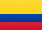

A beautiful `svg` + `png` + `sass` + `css` collection of <!-- count -->264<!-- /count --> flags by [Yefferson Marín](https://github.com/yammadev).

[](https://github.com/yammadev/flag-icons/actions/workflows/ci.yml)
[](https://www.npmjs.com/package/@yammadev/flag-icons)
[](https://www.jsdelivr.com/package/gh/yammadev/flag-icons)
[](LICENSE)

**[Live demo & search →](https://yammadev.github.io/flag-icons/)**

- Every [ISO 3166-1 alpha-2](https://en.wikipedia.org/wiki/ISO_3166-1_alpha-2) country, plus England, Scotland, Wales, Northern Ireland, Shetland, California and 8 extras (continents, EU, World, Pride).
- Optimized `svg`, and `png` at `1x`, `2x` and `3x`.
- Plain CSS, or Sass with variables and mixins to ship only the flags you need.
- `flags.json` with every code and name, for selects and pickers.

## Install

**CDN** (no install):

```html
<link rel="stylesheet" href="https://cdn.jsdelivr.net/gh/yammadev/flag-icons@3.1.0/css/flag-icons.min.css">
```

**npm**:

```sh
npm install @yammadev/flag-icons
```

```js
import '@yammadev/flag-icons/css/flag-icons.min.css';
```

**Manual**: download the repository and copy the `css` and `svg` folders side by side into your project (the CSS loads the images from `../svg/`).

```html
<link rel="stylesheet" href="/css/flag-icons.min.css">
```

## Usage

Add the class `flag-icons` followed by the flag code. Works on any element (`<i>`, `<span>`, `<div>`, …):

```html
<i class="flag-icons CO"></i>              <!-- 4:3 rectangle -->
<i class="flag-icons square CO"></i>       <!-- square box, flag keeps its proportions -->
<i class="flag-icons square fill CO"></i>  <!-- square box, flag fills it (crops the sides) -->
```

Codes are uppercase, as listed in the [Reference](#reference).

### Size

Flags are `1em` high, so they follow the `font-size` of their parent:

```html
<i class="flag-icons CO" style="font-size: 2rem"></i>
```

Or set the size directly:

```css
.flag-icons        { height: 2em; width: 2.6667em; line-height: 2em; }
.flag-icons.square { width: 2em; }
```

## Sass

Configure the library with the module system:

```scss
@use "@yammadev/flag-icons/sass/flag-icons" with (
  $flag-icons-path: "/assets/flags",     // where the .svg files are served from
  $flag-icons-flags: ("CO", "MX", "ES"), // only generate these classes
  $flag-icons-height: 1.25em
);
```

Use a flag on your own selectors without the generated classes:

```scss
@use "@yammadev/flag-icons/sass/mixins" as fi;

.lang-es::before { @include fi.flag("ES"); }               // box + image
.country[data-code="MX"] { @include fi.image("MX"); }      // image only
```

| Variable | Default | Description |
| --- | --- | --- |
| `$flag-icons-path` | `"../svg"` | Folder of the `.svg` files, relative to the compiled CSS. |
| `$flag-icons-flags` | all | List of codes that get a class. |
| `$flag-icons-class` | `"flag-icons"` | Base class name. |
| `$flag-icons-height` | `1em` | Default height. |
| `$flag-icons-ratio` | `4/3` | Width / height of the rectangle. |

The classic `@import` keeps working (variables first, then the import):

```scss
$flag-icons-path: "/assets/flags";
@import "flag-icons/sass/flag-icons";
```

## JavaScript data

`flags.json` (the package `main`) lists every flag:

```js
import flags from '@yammadev/flag-icons' with { type: 'json' };
// { extras: [{ code: 'CAF', name: 'Africa' }, …], countries: [{ code: 'AD', name: 'Andorra' }, …] }
```

## Upgrading from 3.0

Nothing to change: same files, same paths and same classes. The CSS now also works on elements other than `<i>` and `<span>`, and it no longer uses an element in the selector, so your own `.flag-icons { … }` rules override it without `!important`.

## Development

Requires [Node.js](https://nodejs.org/) 18 or newer.

```sh
npm install
npm run build    # flags.json -> Sass lists + README reference, then Sass -> css/
npm test         # checks files, classes, Sass APIs and backwards compatibility
```

To add a flag:

1. Put `CODE.svg` in `svg/` (21×15, same style as the others).
2. Add `{ "code": "CODE", "name": "…" }` to `flags.json`.
3. Run `npm run assets` (optimizes the svg and renders the missing png) and `npm run build`.

Issues and pull requests are more than welcome.

## Credits & license

Flag artwork is based on [madebybowtie/FlagKit](https://github.com/madebybowtie/FlagKit) (MIT). `AQ` and `EH` were drawn for this project in the same style.

Released under the [MIT license](LICENSE). See the [changelog](CHANGELOG.md) for release notes.

Looking for brand icons? Check out [yammadev/brand-icons](https://github.com/yammadev/brand-icons).

## Reference

<!-- reference:start -->
### Extras

*8* flags:

| Flag | Code | Name |
| :---: | :---: | --- |
|  | `CAF` | Africa |
|  | `CAS` | Asia |
|  | `CNA` | North America |
|  | `COC` | Oceania |
|  | `CSA` | South America |
|  | `EU` | European Union |
|  | `WW` | World |
|  | `LGBT` | Pride |

### Countries

*256* flags:

| Flag | Code | Name |
| :---: | :---: | --- |
|  | `AD` | Andorra |
|  | `AE` | United Arab Emirates |
|  | `AF` | Afghanistan |
|  | `AG` | Antigua & Barbuda |
|  | `AI` | Anguilla |
|  | `AL` | Albania |
| 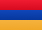 | `AM` | Armenia |
|  | `AO` | Angola |
|  | `AQ` | Antarctica |
|  | `AR` | Argentina |
|  | `AS` | American Samoa |
|  | `AT` | Austria |
|  | `AU` | Australia |
|  | `AW` | Aruba |
| 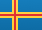 | `AX` | Åland Islands |
|  | `AZ` | Azerbaijan |
|  | `BA` | Bosnia & Herzegovina |
|  | `BB` | Barbados |
|  | `BD` | Bangladesh |
|  | `BE` | Belgium |
| 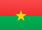 | `BF` | Burkina Faso |
|  | `BG` | Bulgaria |
|  | `BH` | Bahrain |
|  | `BI` | Burundi |
| 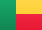 | `BJ` | Benin |
|  | `BL` | St. Barthélemy |
|  | `BM` | Bermuda |
|  | `BN` | Brunei |
|  | `BO` | Bolivia |
|  | `BQ` | Caribbean Netherlands |
|  | `BR` | Brazil |
|  | `BS` | Bahamas |
|  | `BT` | Bhutan |
|  | `BV` | Bouvet Island |
|  | `BW` | Botswana |
|  | `BY` | Belarus |
|  | `BZ` | Belize |
|  | `CA` | Canada |
|  | `CC` | Cocos (Keeling) Islands |
| 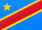 | `CD` | Congo - Kinshasa |
| 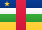 | `CF` | Central African Republic |
|  | `CG` | Congo - Brazzaville |
|  | `CH` | Switzerland |
|  | `CI` | Côte d’Ivoire |
|  | `CK` | Cook Islands |
|  | `CL` | Chile |
| 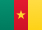 | `CM` | Cameroon |
|  | `CN` | China |
|  | `CO` | Colombia |
|  | `CR` | Costa Rica |
|  | `CU` | Cuba |
|  | `CV` | Cabo Verde |
|  | `CW` | Curaçao |
|  | `CX` | Christmas Island |
|  | `CY` | Cyprus |
|  | `CZ` | Czechia |
|  | `DE` | Germany |
|  | `DJ` | Djibouti |
|  | `DK` | Denmark |
|  | `DM` | Dominica |
|  | `DO` | Dominican Republic |
| 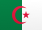 | `DZ` | Algeria |
| 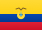 | `EC` | Ecuador |
|  | `EE` | Estonia |
|  | `EG` | Egypt |
| 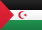 | `EH` | Western Sahara |
| 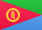 | `ER` | Eritrea |
|  | `ES` | Spain |
| 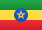 | `ET` | Ethiopia |
|  | `FI` | Finland |
|  | `FJ` | Fiji |
|  | `FK` | Falkland Islands |
|  | `FM` | Micronesia |
|  | `FO` | Faroe Islands |
|  | `FR` | France |
| 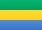 | `GA` | Gabon |
|  | `GB` | United Kingdom |
|  | `GB-ENG` | England |
|  | `GB-NIR` | Northern Ireland |
|  | `GB-SCT` | Scotland |
|  | `GB-WLS` | Wales |
|  | `GB-ZET` | Shetland |
| 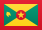 | `GD` | Grenada |
|  | `GE` | Georgia |
| 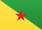 | `GF` | French Guiana |
|  | `GG` | Guernsey |
|  | `GH` | Ghana |
|  | `GI` | Gibraltar |
|  | `GL` | Greenland |
| 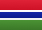 | `GM` | Gambia |
|  | `GN` | Guinea |
|  | `GP` | Guadeloupe |
|  | `GQ` | Equatorial Guinea |
|  | `GR` | Greece |
|  | `GS` | So. Georgia & So. Sandwich Isl. |
|  | `GT` | Guatemala |
|  | `GU` | Guam |
|  | `GW` | Guinea-Bissau |
|  | `GY` | Guyana |
|  | `HK` | Hong Kong (China) |
|  | `HM` | Heard & McDonald Islands |
|  | `HN` | Honduras |
|  | `HR` | Croatia |
|  | `HT` | Haiti |
|  | `HU` | Hungary |
|  | `ID` | Indonesia |
|  | `IE` | Ireland |
|  | `IL` | Israel |
|  | `IM` | Isle of Man |
|  | `IN` | India |
|  | `IO` | British Indian Ocean Territory |
|  | `IQ` | Iraq |
|  | `IR` | Iran |
|  | `IS` | Iceland |
|  | `IT` | Italy |
|  | `JE` | Jersey |
|  | `JM` | Jamaica |
|  | `JO` | Jordan |
|  | `JP` | Japan |
|  | `KE` | Kenya |
|  | `KG` | Kyrgyzstan |
|  | `KH` | Cambodia |
|  | `KI` | Kiribati |
| 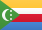 | `KM` | Comoros |
|  | `KN` | St. Kitts & Nevis |
|  | `KP` | North Korea |
|  | `KR` | South Korea |
|  | `KW` | Kuwait |
|  | `KY` | Cayman Islands |
| 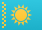 | `KZ` | Kazakhstan |
|  | `LA` | Laos |
|  | `LB` | Lebanon |
|  | `LC` | St. Lucia |
|  | `LI` | Liechtenstein |
|  | `LK` | Sri Lanka |
|  | `LR` | Liberia |
|  | `LS` | Lesotho |
| 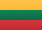 | `LT` | Lithuania |
|  | `LU` | Luxembourg |
|  | `LV` | Latvia |
|  | `LY` | Libya |
|  | `MA` | Morocco |
|  | `MC` | Monaco |
|  | `MD` | Moldova |
|  | `ME` | Montenegro |
|  | `MF` | St. Martin |
|  | `MG` | Madagascar |
|  | `MH` | Marshall Islands |
|  | `MK` | North Macedonia |
|  | `ML` | Mali |
|  | `MM` | Myanmar (Burma) |
|  | `MN` | Mongolia |
|  | `MO` | Macau (China) |
|  | `MP` | Northern Mariana Islands |
|  | `MQ` | Martinique |
|  | `MR` | Mauritania |
|  | `MS` | Montserrat |
|  | `MT` | Malta |
| 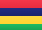 | `MU` | Mauritius |
|  | `MV` | Maldives |
|  | `MW` | Malawi |
|  | `MX` | Mexico |
|  | `MY` | Malaysia |
|  | `MZ` | Mozambique |
|  | `NA` | Namibia |
|  | `NC` | New Caledonia |
|  | `NE` | Niger |
|  | `NF` | Norfolk Island |
|  | `NG` | Nigeria |
|  | `NI` | Nicaragua |
|  | `NL` | Netherlands |
|  | `NO` | Norway |
|  | `NP` | Nepal |
|  | `NR` | Nauru |
|  | `NU` | Niue |
|  | `NZ` | New Zealand |
|  | `OM` | Oman |
|  | `PA` | Panama |
|  | `PE` | Peru |
|  | `PF` | French Polynesia |
|  | `PG` | Papua New Guinea |
|  | `PH` | Philippines |
|  | `PK` | Pakistan |
|  | `PL` | Poland |
|  | `PM` | St. Pierre & Miquelon |
|  | `PN` | Pitcairn Islands |
|  | `PR` | Puerto Rico |
|  | `PS` | Palestinian Territories |
|  | `PT` | Portugal |
|  | `PW` | Palau |
|  | `PY` | Paraguay |
|  | `QA` | Qatar |
|  | `RE` | Réunion |
|  | `RO` | Romania |
|  | `RS` | Serbia |
| 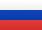 | `RU` | Russia |
| 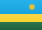 | `RW` | Rwanda |
|  | `SA` | Saudi Arabia |
|  | `SB` | Solomon Islands |
|  | `SC` | Seychelles |
|  | `SD` | Sudan |
|  | `SE` | Sweden |
|  | `SG` | Singapore |
|  | `SH` | St. Helena |
|  | `SI` | Slovenia |
|  | `SJ` | Svalbard & Jan Mayen |
|  | `SK` | Slovakia |
|  | `SL` | Sierra Leone |
|  | `SM` | San Marino |
| 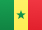 | `SN` | Senegal |
|  | `SO` | Somalia |
| 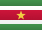 | `SR` | Suriname |
|  | `SS` | South Sudan |
|  | `ST` | São Tomé & Príncipe |
|  | `SV` | El Salvador |
|  | `SX` | Sint Maarten |
|  | `SY` | Syria |
|  | `SZ` | Eswatini |
|  | `TC` | Turks & Caicos Islands |
|  | `TD` | Chad |
|  | `TF` | French Southern Territories |
| 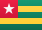 | `TG` | Togo |
|  | `TH` | Thailand |
|  | `TJ` | Tajikistan |
|  | `TK` | Tokelau |
|  | `TL` | Timor-Leste |
|  | `TM` | Turkmenistan |
|  | `TN` | Tunisia |
|  | `TO` | Tonga |
|  | `TR` | Türkiye |
|  | `TT` | Trinidad & Tobago |
|  | `TV` | Tuvalu |
|  | `TW` | Taiwan |
| 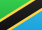 | `TZ` | Tanzania |
| 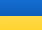 | `UA` | Ukraine |
|  | `UG` | Uganda |
|  | `UM` | U.S. Outlying Islands |
|  | `US` | United States |
|  | `US-CA` | California |
| 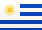 | `UY` | Uruguay |
|  | `UZ` | Uzbekistan |
|  | `VA` | Vatican City |
|  | `VC` | St. Vincent & Grenadines |
| 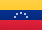 | `VE` | Venezuela |
|  | `VG` | British Virgin Islands |
|  | `VI` | U.S. Virgin Islands |
|  | `VN` | Vietnam |
|  | `VU` | Vanuatu |
|  | `WF` | Wallis & Futuna |
|  | `WS` | Samoa |
|  | `XK` | Kosovo |
|  | `YE` | Yemen |
|  | `YT` | Mayotte |
|  | `ZA` | South Africa |
|  | `ZM` | Zambia |
|  | `ZW` | Zimbabwe |
<!-- reference:end -->
